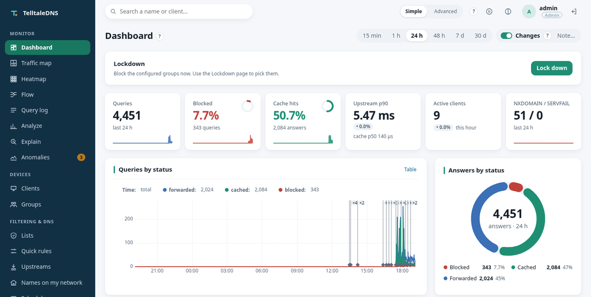
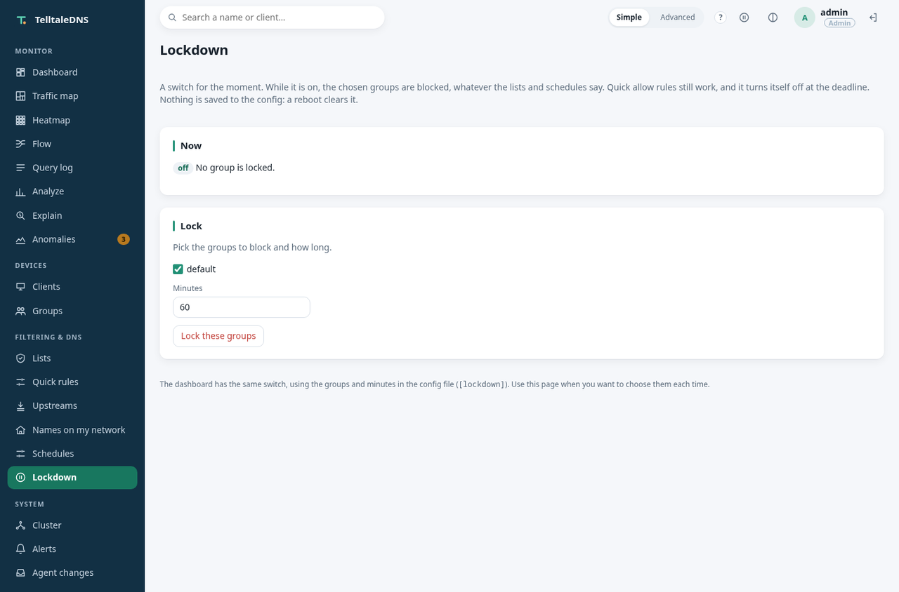
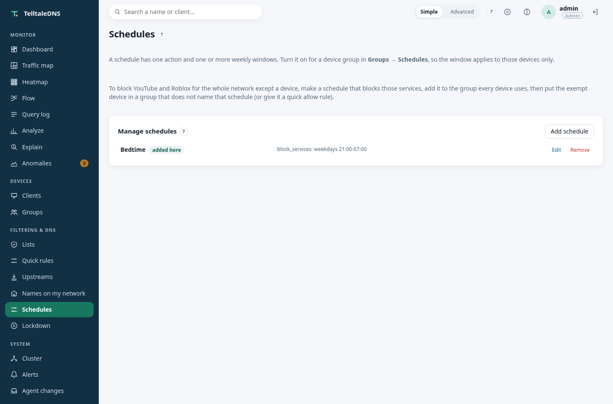
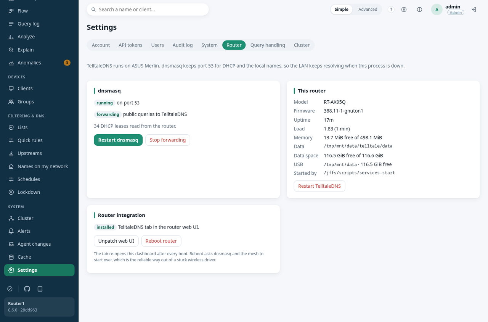
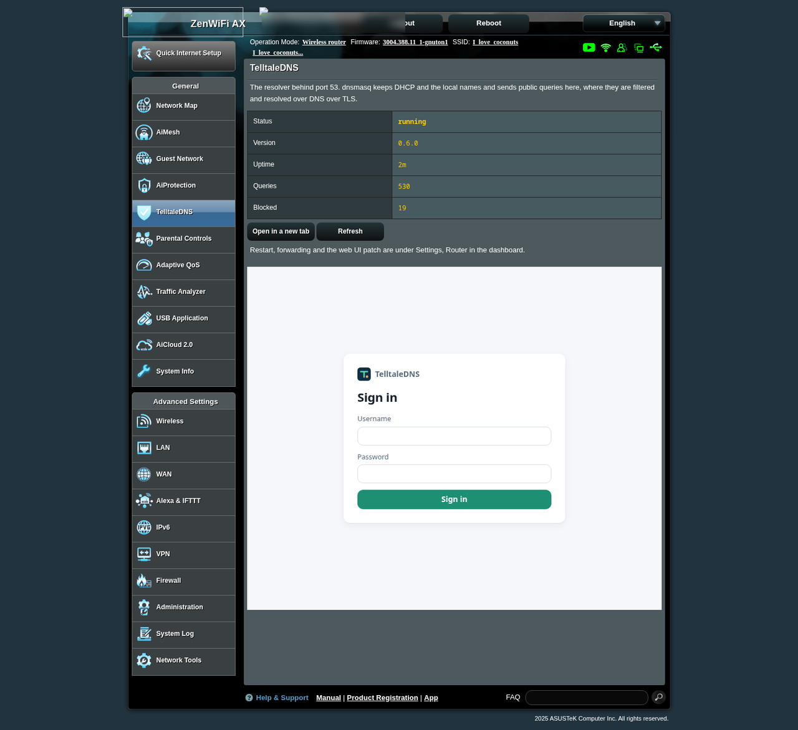

# TelltaleDNS for ASUS Merlin and OpenWrt

[](https://github.com/bongomanuk/telltaledns-merlin-openwrt/actions/workflows/merlin-binaries.yml)
[](https://github.com/bongomanuk/telltaledns-merlin-openwrt/actions/workflows/merlin-feed.yml)
[](#license)

Static, self-contained builds of [TelltaleDNS](https://github.com/paimonsoror/telltaledns) for **ASUS Merlin (Asuswrt-Merlin) and OpenWrt routers**. One binary with the web UI embedded, no Docker and no systemd. The ASUS Merlin builds need no Entware to run; the OpenWrt builds are apk packages for OpenWrt 25.12+.

> **This fork is proudly not built by Claude.**

These are unofficial builds. There is no guarantee that they work on your router,
and a resolver that owns port 53 can take the LAN offline while it is broken.
Keep SSH access and the undo steps in the install guide. Use at your own risk.

## Why this fork exists

I needed one thing: a way to manage my kids' internet access on a schedule, per
device, without buying new hardware or moving DNS off the router. I did not find
anything that did it well on Merlin, so I adapted TelltaleDNS, which already had
the filtering and the per-device rules.

Everything here follows from that: schedules that block whole services such as
YouTube and Roblox, groups that leave one or two devices out, a lockdown button
for the moment a rule has to change now, and packaging that leaves the router's
flash and its port 53 alone.

It is not a general router project. The Merlin build is the one I run at home, on
an RT-AX95Q. The OpenWrt packages are built the same way, but I have no OpenWrt
hardware to test them, so treat those as untested.

Issues and pull requests are welcome, in particular reports from OpenWrt
routers: the model, `apk --print-arch`, and what worked or did not.

## Screenshots

| | |
|---|---|
|  |  |
| The dashboard, with the lockdown switch at the top | Instant lockdown: pick the groups and the minutes |
|  |  |
| Weekly schedules for services such as YouTube and Roblox | Settings, Router: dnsmasq, storage, restarts, the web UI patch |
|  | |
| The TelltaleDNS entry in the Merlin menu, with the dashboard embedded | |

## What this fork is, and why it exists

This is a fork of [paimonsoror/telltaledns](https://github.com/paimonsoror/telltaledns). Upstream targets Docker, Kubernetes, and systemd hosts; routers have none of those. Many Merlin models, including the RT-AX95Q / ZenWiFi XT8, are 32-bit ARM with a small JFFS partition, and OpenWrt 25.12+ uses apk, not a conventional package manager. On these routers you need a static file or a native package, not an image.

This fork adds:

- **Static ARMv7 and ARM64 binaries** with the web UI compiled in: one file, no Entware, no shared libraries, no container.
- **Flash-friendly installs:** the binary is gzip-compressed on flash (about 15 MB) and unpacked to RAM at start. The database, query log and blocklists live on the USB drive, and never on the router's flash.
- **Router UI integration:** a **Services → TelltaleDNS** page in LuCI, and a **TelltaleDNS** entry in the Merlin web UI's main menu.
- An **opkg/Entware feed** at `https://bongomanuk.github.io/telltaledns-merlin-openwrt/entware`, rebuilt by the [`merlin-feed`](.github/workflows/merlin-feed.yml) workflow.
- **OpenWrt 25.12+ apk packages** for armv7, aarch64 and x86_64 at `https://bongomanuk.github.io/telltaledns-merlin-openwrt/openwrt/`.
- A [`merlin-binaries`](.github/workflows/merlin-binaries.yml) workflow that builds and checksums the raw binaries.
- An [`upstream-watch`](.github/workflows/upstream-watch.yml) workflow that rebuilds the packages for each new upstream release.
- A [Merlin install guide](deploy/merlin/README.md) with the full model list, the dnsmasq setup, the config, and a boot-time `/jffs/scripts/services-start` script.

The resolver source is upstream's. This fork adds only the router packaging.

## Install

### From the opkg feed (recommended, needs Entware)

If the router already runs [Entware](https://github.com/Entware/Entware) (usually installed with `amtm` on a USB drive), add the feed and install:

```sh
echo 'src/gz telltale https://bongomanuk.github.io/telltaledns-merlin-openwrt/entware' >> /opt/etc/opkg/customfeeds.conf
opkg update
opkg install telltale
```

The package installs the static binary to `/opt/sbin/telltale`, the config to `/opt/etc/telltale/telltale.toml` (a conffile), an init script at `/opt/etc/init.d/S99telltale`, and keeps its data and query log on the USB at `/opt/var/lib/telltale`, away from the router's flash.

Point dnsmasq at it, then start the service:

```sh
add=/jffs/configs/dnsmasq.conf.add
touch "$add"
for line in no-resolv strict-order add-mac 'server=127.0.0.1#5354' 'server=9.9.9.9' 'server=1.1.1.1'; do
    grep -qx "$line" "$add" || echo "$line" >> "$add"
done
service restart_dnsmasq
/opt/etc/init.d/S99telltale start
```

dnsmasq keeps port 53, DHCP, `home.lan`, `router.asus.com` and the mesh nodes working. It sends public queries to TelltaleDNS on `127.0.0.1:5354`, and falls back to `9.9.9.9`/`1.1.1.1` when TelltaleDNS is down. Device names come from `/var/lib/misc/dnsmasq.leases`.

Then create the first admin and open the UI:

```sh
/opt/sbin/telltale auth setup-token -c /opt/etc/telltale/telltale.toml
# http://192.168.1.1:8053/
```

Update with `opkg update && opkg upgrade telltale`; remove with `/opt/etc/init.d/S99telltale stop && opkg remove telltale` (the config and data are kept). The feed is for Entware's `armv7-3.2` and `aarch64-3.10` repositories, and it is unsigned.

### Manually, without Entware

Download the **flash-friendly bundle** (`telltale-<version>-merlin-armv7.tar.gz` or `-aarch64`) from the release or the [Merlin bundles](https://bongomanuk.github.io/telltaledns-merlin-openwrt/merlin/), extract it on the router, and run `./install.sh`. The bundle keeps the binary gzip-compressed (about 15 MB on flash) and unpacks it to `/tmp` at start. The installer also puts `data_dir` (state database, query log, blocklists) on the first mounted USB volume. With no USB volume it uses `/tmp/telltale-data`, which is RAM, so nothing is written to the router's flash at runtime. It adds a **TelltaleDNS** entry to the router's web UI by default (`--no-ui` skips it). The drive must be ext2/3/4 or NTFS; this firmware does not read exFAT. The raw binary is also in the release. [`deploy/merlin/README.md`](deploy/merlin/README.md) covers dnsmasq, the first run, and the setup token.

### On OpenWrt 25.12+ (apk v3)

Current OpenWrt uses apk; the same build produces unsigned `.apk` packages for armv7, aarch64, x86_64 and x86 (i686). The package keeps the binary gzip-compressed (about 14 MB on flash), unpacks it to `/tmp` at start, and installs a UCI config at `/etc/config/telltale`. Install the one matching `apk --print-arch`:

```sh
apk add --allow-untrusted https://bongomanuk.github.io/telltaledns-merlin-openwrt/openwrt/telltale-<version>-<arch>.apk
```

Leave dnsmasq on port 53 and point it at TelltaleDNS on `127.0.0.1:5354` (`noresolv`, `strictorder`, servers `127.0.0.1#5354`, `9.9.9.9`, `1.1.1.1`), then start `/etc/init.d/telltale`. dnsmasq keeps DHCP and `*.lan`; TelltaleDNS filters public queries and reads `/tmp/dhcp.leases` for device names. Install `luci-app-telltale` too for the **Services → TelltaleDNS** page. [`deploy/openwrt/README.md`](deploy/openwrt/README.md) has the arch table, the exact uci commands, flash/data notes, and updates. OpenWrt 24.10 and older (opkg) is end of life and is not packaged.

## Parental controls

Everything below is in the web UI (`http://<router>:8053/`). The router-specific parts are in
**Settings → Router**: dnsmasq state and port, forwarding on/off, DHCP leases, the data and USB
mounts with free space, model, firmware, uptime, load and memory, the TelltaleDNS tab in the
router UI, start-at-boot (OpenWrt), and restarts for dnsmasq, TelltaleDNS, or the router. The
rest works the same on any host.

**Block a service for the whole network except one or two devices.** Services are bundles of
domains (`youtube`, `roblox`, `tiktok`, `discord`, …):

1. **Groups** → make a group for the family, say `family`, and tick YouTube and Roblox under
   *Blocked services*. Leave its *Schedules* empty.
2. Make a second group, say `exempt`, with the same lists but no blocked services.
3. **Clients** → put the devices that must keep access in `exempt` (by name, IP, or MAC).
4. Every device that matches no client uses the default group, so it gets `family`. If the
   default group is not the one you want, assign the other devices to `family` explicitly.

A device matches a client by name, IP address, MAC, or a network; the highest group priority
wins when more than one matches.

**Block it only at certain times.** **Schedules** → make a schedule:

- *During the windows*: `block_services` (extra services) or `block_all` (a bedtime where
  everything except quick allow rules and local names is blocked).
- *Services*: YouTube, Roblox, anything else.
- *Windows*: one per line, `weekdays 21:00-07:00`, `sat,sun 23:00-08:00`. An end before the
  start runs past midnight.
- *Time zone*: an IANA name such as `Europe/London` (default: the router's).

Then open **Groups**, edit the group, and tick the schedule under *Schedules*. The group's
devices follow it; other groups do not. The same schedule can be attached to several groups.

**Only let one device through a blocked service at a time.** Put the device in its own group
without the blocked service, and use a schedule with `block_services` on the group everyone
else uses. Quick rules (**Quick rules**) allow a single name for everyone; groups are the way
to allow a whole service for one device.

## Lockdown now

**Filtering & DNS → Lockdown** is the switch for the moment a rule needs to change now.
Pick the groups, set the minutes, and press **Lock these groups**. The same switch is on
the dashboard; it uses the groups and minutes from `[lockdown]` in `telltale.toml`
(`groups = []` means every group, `minutes = 60` is the default).

While it is on, those groups are blocked whatever the lists and schedules say. Quick
allow rules still work, local names still resolve, and it turns itself off at the
deadline. A reboot clears it. Nothing is written to the config.

## Supported ASUS Merlin routers

Your router's `uname -m` picks the binary. Run it on the router if you are unsure.

| `uname -m` | Binary | Routers |
|---|---|---|
| `armv7l` | `telltale-armv7-linux` | **RT-AX95Q / ZenWiFi XT8**, RT-AX58U / RT-AX58U v2 ★, RT-AX82U v1/v2 ★, RT-AX92U ★, RT-AX5400 ★, TUF-AX3000 v1/v2 ★, TUF-AX5400 v1 ★, DSL-AX82U / DSL-AX5400 ★, RT-AXE95Q / ZenWiFi ET8 ★, RT-BE58_GO, RT-BE92U, RT-AX56U (end of support) |
| `aarch64` | `telltale-aarch64-linux` | RT-AX86U / RT-AX86U Pro, RT-AX88U / RT-AX88U Pro, RT-AX68U, GT-AX11000 / GT-AX11000 Pro, GT-AXE11000, GT-AX6000, GT-AXE16000, ZenWiFi Pro XT12, RT-BE86U, RT-BE88U, RT-BE96U, GT-BE98 ★ / GT-BE98 Pro, GT-BE25000 ★, GT-BE19000AI, RT-AC86U (end of support), GT-AC2900 (end of support) |

★ = added by [GNUton's Merlin fork](https://gnuton.github.io/asuswrt-merlin.ng/); the rest are in the main Asuswrt-Merlin releases.

**Not supported:**

| Routers | Why |
|---|---|
| RT-N66U, RT-AC66U (original), RT-N16 | MIPS; there is no MIPS build |
| RT-AC56U, RT-AC66U B1, RT-AC68U, RT-AC87U, RT-AC3200, RT-AC88U, RT-AC3100, RT-AC5300 | 32-bit ARM, but the firmware runs Linux 2.6.36; this build needs Linux 3.2+ |
| anything not running Asuswrt-Merlin | the installer uses `/jffs/scripts`, which stock Asuswrt does not run reliably |

`armv7l` and `aarch64` are the only two `uname -m` answers that work. `uname -r` shows the kernel; if it starts with `2.6.36`, the binary will not run.

## Where the traffic goes

The router's dnsmasq runs DHCP and DNS, and it stays on port 53. TelltaleDNS runs on
`127.0.0.1:5354`, where only dnsmasq can reach it. A lookup takes this path:

1. A device asks the router (`192.168.1.1:53`).
2. dnsmasq answers its own names itself: DHCP hostnames, `home.lan`, `router.asus.com`.
3. For everything else, dnsmasq forwards the query to TelltaleDNS on `127.0.0.1:5354`
   and adds the device's MAC address (`add-mac`).
4. TelltaleDNS filters the name and asks Cloudflare or Quad9 over DNS over TLS.
5. If TelltaleDNS is not running, dnsmasq sends the query to `9.9.9.9` or `1.1.1.1`,
   so the LAN keeps working.

TelltaleDNS reads that MAC from the query and looks it up in the dnsmasq lease file, so
the query log, top clients and per-device rules see the device, not the router.

There is no port 53 conflict: dnsmasq never gives up port 53.

### Flash wear

Nothing is written to the router's flash while TelltaleDNS runs. The install writes the
compressed binary, the config and the boot hook once. The database, query log and
blocklists go to the USB drive. Without a USB drive they go to `/tmp/telltale-data`,
which is RAM, and are lost on reboot. The router's own syslog (`/jffs/syslog.log`) is a
firmware setting and is outside this app; turn it off under Administration, System if
you want to cut that down too.


## Builds and packages

- **Actions:** [all workflow runs](https://github.com/bongomanuk/telltaledns-merlin-openwrt/actions)
- **Releases:** [releases](https://github.com/bongomanuk/telltaledns-merlin-openwrt/releases) (raw binaries, Entware `.ipk`, OpenWrt `.apk`, `SHA256SUMS`)
- **Entware feed:** `https://bongomanuk.github.io/telltaledns-merlin-openwrt/entware`
- **OpenWrt packages:** `https://bongomanuk.github.io/telltaledns-merlin-openwrt/openwrt/`
- **Merlin bundles:** `https://bongomanuk.github.io/telltaledns-merlin-openwrt/merlin/`
- **Artifacts:** the `telltale-merlin-<run>` artifact on any `merlin-binaries` or `merlin-feed` run

## Build it yourself

- **Raw binaries:** Actions → **merlin-binaries** → *Run workflow* (or push a `v*` tag). The `telltale-merlin-<run>` artifact contains the three static binaries and `SHA256SUMS`.
- **The packages:** Actions → **merlin-feed** → *Run workflow* (or push a `v*` tag). It builds the binaries, makes the Entware `armv7-3.2`/`aarch64-3.10` packages, makes the OpenWrt 25.12 apk packages, writes the indexes, and deploys them to GitHub Pages.
- **Upstream tracking:** the [`upstream-watch`](.github/workflows/upstream-watch.yml) workflow runs daily. It merges `paimonsoror/telltaledns` `main` into this fork (keeping this fork's README, packaging and workflows on conflicts), then dispatches `merlin-feed` for the latest upstream release if this fork has not built it yet. The source stays current and every release gets packages and a GitHub release.
- **Locally:** the Entware scripts are in [`deploy/merlin/opkg/`](deploy/merlin/opkg/) and the OpenWrt scripts in [`deploy/openwrt/`](deploy/openwrt/); the builds use the project's usual `cargo zigbuild` targets.

## Documentation

This fork only changes packaging. The full documentation lives upstream:

| Read this | For |
|---|---|
| [Upstream README](https://github.com/paimonsoror/telltaledns#readme) | what TelltaleDNS is and what it does |
| [`docs/running.md`](https://github.com/paimonsoror/telltaledns/blob/main/docs/running.md) | native/Pi install, clusters, updates |
| [`docs/configuration.md`](https://github.com/paimonsoror/telltaledns/blob/main/docs/configuration.md) | every configuration key |
| [`docs/`](https://github.com/paimonsoror/telltaledns/tree/main/docs) | API, DNS, filtering, observability, security |
| [`spec/`](https://github.com/paimonsoror/telltaledns/tree/main/spec) | the build specification and decisions |
| [Project site](https://paimonsoror.github.io/telltaledns/) | FAQ, guides, release notes |
| [Upstream releases](https://github.com/paimonsoror/telltaledns/releases) | upstream binaries and images |
| [`deploy/merlin/`](deploy/merlin/README.md) | **this fork:** ASUS Merlin install, models, dnsmasq, boot script |
| [`deploy/openwrt/`](deploy/openwrt/README.md) | **this fork:** OpenWrt 25.12+ apk packages, archs, port 53 |

## License

Apache-2.0 OR MIT, the same as upstream. See [LICENSE-APACHE](LICENSE-APACHE) and [LICENSE-MIT](LICENSE-MIT).

TelltaleDNS is by [paimonsoror](https://github.com/paimonsoror/telltaledns).
